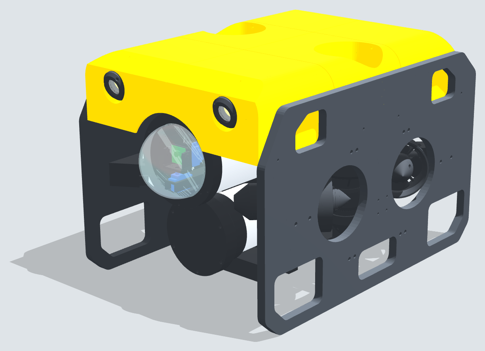

# TinkerSub KB-1

**A printable, open-source ROV you can build and change.**

TinkerSub is a small tethered underwater ROV that you build from a 3D printer, PVC pipe, a sheet of HDPE and parts from the hardware store. The thrusters are made from 1200 GPH bilge-pump motors. A Raspberry Pi Zero 2 W and a Pico drive it, a camera on a pan-tilt sees through the acrylic dome, and a laptop with a game controller flies it over a Cat6 tether.

KB-1 is the first version, named for Kings Bay in Crystal River, Florida.

## What's in it

| | |
|---|---|
| Size | 351 W x 328 H x 508 L mm (13.8 x 12.9 x 20.0 in) |
| Weight | About 12.5 kg in air before foam and ballast, trimmed to just buoyant |
| Hull | 4" PVC electronics hull with a 100 mm acrylic dome; 3" PVC battery pod underneath |
| Frame | Printed PETG station frames, two 1/2" HDPE side plates, a yellow printed cowl with foam and lights |
| Thrusters | 6 oil-filled thrusters from 1200 GPH bilge-pump motors: 4 vectored at 45 deg in the corners, 2 vertical |
| Power | 3S8P 18650 pack (11.1-12.6 V) in the pod |
| Electronics | Raspberry Pi Zero 2 W (video + network), Raspberry Pi Pico (thrusters, lights, servos, failsafes), 6 x IBT_2 motor drivers |
| Camera | Arducam on a pan-tilt (+/-90 deg pan, +/-45 deg tilt), streamed over the tether |
| Lights | 2 x Cree XHP50.2 heads in the cowl nose, aimed 15 deg down, PWM dimming |
| Tether | Cat6, data only |
| Printing | 92 parts on a Bambu Lab A1 (256 mm bed): about 2.5 kg black and 1.1 kg yellow PETG |
| Parts cost | Roughly US$1,100-1,300 for everything to buy |

## Start here

Open **[TinkerSub_KB-1_Assembly_Guide.pdf](TinkerSub_KB-1_Assembly_Guide.pdf)**. It goes from the shopping list and printing to the first dive:

- Shopping list, print settings and ground rules
- Cutting the side plates from one 24 x 24 in HDPE sheet, with 1:1 paper templates (Appendix A)
- Building the thrusters, sled, hull, battery pod, lights and frame, step by step
- The electronics: schematic, wiring diagram, wire list and bench tests
- Leak testing, trim and the first dives
- A heat-set insert chart for every printed part and picture-by-picture assembly pages (Appendix B)

## Repository layout

| Path | Contents |
|---|---|
| `TinkerSub_KB-1_Assembly_Guide.pdf` | The build guide |
| `TinkerSub_KB-1_Core.3mf` | Bambu Studio project: thrusters, hull parts, sled, camera pan-tilt, battery pod, lights, junction box |
| `TinkerSub_KB-1_Frame.3mf` | Bambu Studio project: stations, brackets, pylons, belly pan and the yellow cowl |
| `TinkerSub_KB-1_Reprint_2026-10-20.3mf` | Only the parts changed on 2026-10-20, for anyone who printed earlier |
| `STL/` | Every printed part in print orientation (mm), in build order |
| `CAD/` | Side-plate DXFs and cutting templates, STEP files for most parts (Fusion 360, FreeCAD, Onshape...) and the whole ROV as a mesh (`CAD/STEP/TinkerSub_KB-1_assembly_mesh.3mf`). The full assembly STEP is over GitHub's 100 MB file limit, so it's in the [Releases](../../releases) downloads as `TinkerSub_KB-1_assembly_step.zip` |
| `Firmware/` | Pico firmware, the Pi bridge, the topside program and tests (see `Firmware/README.md`) |
| `Source/` | The Python generators for every part, the 3MFs, the templates, the STEP files, the renders and the guide, with their input files. `python3 Source/build.py all` rebuilds everything; see `Source/README.md` |
| `docs/` | [Battery pack build](docs/Battery_Pack_Build.md): cell matching, welding, BMS wiring, first charge |
| `Images/` | Renders, assembly pictures, part pictures, diagrams and the electronics drawings |
| `Parts_to_buy.csv`, `BOM_printed_parts.csv`, `Pipe_cut_list.csv`, `Wire_list.csv` | Everything to buy (exact sizes, prices, sources), print, cut and wire |
| `CHANGELOG.md` | What changed in the files, and when: check it if you printed parts earlier |

Every printed part has a three-digit number debossed into it, and its file name starts with that number. The first digit is the subsystem: 1 thrusters, 2 hull and sled, 3 battery pod, 4 lights, 5 junction box, 6 stations and brackets, 7 belly pan, 8 cowl, 9 side plates.

## Status

KB-1 is being built for the first time now. The design has been checked in CAD for fit and interference, and the printed parts have been reviewed for printability. It has not yet been depth-tested. The target is 60 ft (18 m). Work down to it in stages, as the guide describes, and treat any depth past your own tests as untested.

## Safety

- The battery is a home-built lithium-ion pack. Build it with a BMS and fuses as [docs/Battery_Pack_Build.md](docs/Battery_Pack_Build.md) shows, never charge it wet, and charge it where a fire would do no harm.
- Leak-test every sealed enclosure empty (vacuum, then a dunk) before electronics or the battery go in.
- The Pico's GPIO is 3.3 V only. Keep the 12 V wiring separate from the logic, as in the wiring diagram.
- Lift the ROV by the lower corner windows of the side plates, never by the cowl, a thruster or the dome.

Found a safety defect or a security problem? Please report it privately, as [SECURITY.md](SECURITY.md) describes, not in a public issue. The control link has no authentication, so keep the tether a direct cable and never connect the ROV to a shared network (details in SECURITY.md).

## Changing it

That's the point. Every part is generated from the Python in `Source/` (manifold3d, trimesh): change a number, run `python3 Source/build.py all`, and the STL, 3MF and STEP files and the guide follow. `Source/README.md` says which file makes which part. Most parts also have a STEP file in `CAD/STEP/parts/` for editing in your CAD program.

Questions, problems and ideas: open an [issue](https://github.com/bgreig/TinkerSub/issues/new/choose). Builds, sourcing tips and modifications: the [wiki](https://github.com/bgreig/TinkerSub/wiki). To change the files, see [CONTRIBUTING.md](CONTRIBUTING.md).

## License

- Hardware (CAD, STL, 3MF, drawings): [CERN-OHL-S-2.0](LICENSE)
- Software (firmware, topside, generators): [MIT](LICENSES/MIT.txt)
- Documentation and images: [CC BY-SA 4.0](LICENSES/CC-BY-SA-4.0.txt)

Source location (CERN-OHL-S section 4): https://github.com/bgreig/TinkerSub

Designed by Brian Greig.
