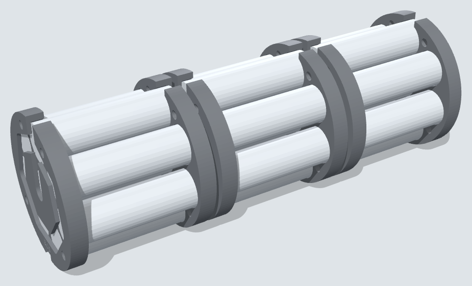

# TinkerSub KB-1: Battery Pack Build

The 3S8P pack for the battery pod. Guide section 11 covers the pod itself; this page covers the pack inside it.

## What you're building

A 3S8P pack: 24 18650 cells in three groups of eight in parallel, with the groups in series, held in six printed plates and protected by a 40 A balancing BMS. It slides into the 3" battery pod and feeds the hull through the 12 AWG lead. Sized for six 1200 GPH thrusters.

The two series links and every centre-to-edge run carry the full pack current, so they are the doubled strips; the balance leads only sense voltage.

| Spec | Value |
| --- | --- |
| Configuration | 3S8P, 24 cells |
| Voltage | 12.6 V full, 11.1 V nominal, 9.0 V empty (3.0 V per cell) |
| Capacity | 8 × your cell capacity, e.g. 2.5 Ah cells give 20 Ah and about 220 Wh |
| Current | 28 A sustained (firmware budget), 30 A fuse in the hull, 35 A fuse at the pack, 40 A BMS trip |
| Per-cell load at 28 A | 3.5 A, inside the rating of most 18650s (look for 5 A or more continuous) |
| Pack length | About 213 mm, in a 300 mm pod |
| Weight | About 1.3 kg with plates |

### Safety rules for the whole build

- Never solder to a cell. Spot-weld nickel to cells; solder only nickel-to-nickel or wire-to-nickel away from the cells.
- Work on a non-flammable bench, with a metal bucket of sand nearby to drop a hot or smoking cell into.
- No rings or watch. Tape over the ends of any tool that could bridge a group.
- Keep loose cells, and the parts of the pack you aren't working on, covered with tape or card.
- Build one group at a time and check its voltage before moving on.
- A cell that gets hot, hisses or swells goes outside into the sand bucket, and it doesn't come back.

## Parts and tools

Most of this is already in the shopping list (`Parts_to_buy.csv`, guide section 4). The new items are the insulator rings, Kapton tape, a pack fuse and the cell tester.

| Qty | Component | Description | Approx. Cost | Source |
| --- | --- | --- | --- | --- |
| 24 + 4 | 18650 cells | Pack cells plus spares to swap out rejects | On hand | On hand |
| 1 | 3S BMS, 40 A, balancing | Pads for B−, B1, B2, B+, P− | $12 | Amazon |
| 6 | 305 cell plate (v2) | Printed holder plates, PETG | — | Printed |
| \~3 m | Pure nickel strip, 8 × 0.2 mm | Cell links; doubled on the main runs, with copper under them (next row). Pure nickel, not nickel-plated steel | $10 | Amazon |
| \~1 m | Copper strip, 8 × 0.15 mm | Under the nickel on the straight runs and series links (28 A) | $8 | Amazon |
| 4 + 16 | M4 threaded rod \~225 mm + nuts (4 rods, 16 nuts) | Pack tie rods | $4 | Hardware store |
| 1 pack | 18650 fish-paper insulator rings | One on every cell's + end | $6 | Amazon |
| 1 roll | Kapton tape, 25 mm | Insulating strips and tabs | $8 | Amazon |
| 1 pack | 18650 PVC wraps | Re-wrap any cell with a torn or nicked wrap | $6 | Amazon |
| 0.6 m | 12 AWG two-core cable, 10 mm OD max (M16 gland) | Pack to hull lead, through the pod gland | $6 | Amazon |
| 1 m | 22 AWG silicone wire | Balance leads, if the BMS has no harness | $5 | Amazon |
| 1 | Inline ATO fuse holder, 12 AWG + 35 A fuse | Pack fuse at B+, inside the pod | $6 | Auto parts store |
| 1 | Silica gel packet, 10 g | Keeps condensation down in the pod | $5 | Amazon |
| 1 | 3S balance charger, 12.6 V | Skip if you already have one | $40–60 | Amazon, hobby shop |

**Tools:** spot welder (or a shop with one), a capacity-testing charger such as the LiitoKala Lii-500 or Opus BT-C3100, multimeter, a 60 W+ soldering iron, heat gun. An internal-resistance meter (YR1035 type, about $30) is optional but makes cell sorting much easier.

## Step 1: Test and match the cells

A parallel group is only as good as its weakest cell, so each of the three groups should end up with the same total capacity. This step takes the longest, often a week with the self-discharge wait, and it's the one that decides how long the pack lasts.

1. Inspect every cell. Reject any with dents, rust, leaks, a damaged top cap, or a wrap torn near the + end. Re-wrap cells whose wrap is only scuffed.
2. Measure the resting voltage. Reject any cell below 2.0 V; cells that sat that low are not safe to recover.
3. Run a full capacity test on each cell with the tester (charge, discharge, record mAh). Write the result on the cell with a paint pen.
4. Recharge each cell to full and let it sit 7–14 days. Reject any cell that drops more than 0.05 V, or ends below 4.10 V. That's self-discharge, and it will drain the whole group.
5. Measure internal resistance if you have the meter. Reject outliers more than 1.5 times the median.
6. Keep the best 24, ideally all the same model. Don't mix cells that differ by more than about 15% in capacity.
7. Sort the 24 by capacity, highest first, and deal them out to groups A, B and C in a snake: A B C C B A A B C, and so on. Check that the three group totals are within 1% of each other; swap single cells to even them out.
8. Bring every cell to the same voltage, about 3.7 V and within 0.02 V of the others, before any welding. Paralleling cells at different voltages makes large currents flow between them.

- [ ] 24 cells tested, matched into three groups within 1%, all at about 3.7 V

## Step 2: Prepare the plates and cells

Each group sits between two plates, with the nickel grooves on the outside faces. The grooves run through the plate floor, so the strip lies flat on the cell ends.

1. Print six 305 cell plates in PETG, grooved face down, plus eight 306 rod spacers. Clear any stringing out of the cell pockets and grooves.
2. Dry-fit one cell in each pocket. It should push in snugly and not rattle. If it's tight, ream the pocket instead of forcing the cell.
3. Stick a fish-paper ring on the + end of every cell. On an 18650, the rim around the + cap is part of the negative can, so a strip that slips onto the rim shorts the cell. The ring stops that.
4. Mark each plate with its group letter and face (A-front, A-rear, B-front and so on). Every plate goes on with its tab notch at the top: to put a plate on the other end of a group, turn it over left-to-right, never top-to-bottom, and the rod holes line up.

## Step 3: Build the three groups

Build group A, check it, then B, then C. All 24 cells point the same way, with + toward the rear of the pod.

1. Set a front plate grooves-down on the bench. Push group A's eight cells in, − end down. Press the rear plate onto the + ends, grooves up.
2. Dial in the welder on a dead cell or a scrap of can first. A good weld tears the nickel when you peel the strip, leaving a hole, instead of lifting cleanly. A 0.2 mm strip needs a capable welder; if yours struggles, take the groups to a shop.
3. Lay strip in the grooves on the rear (+) face: the ring of short runs around the 7 outer cells, plus the straight run from the centre cell through the top cell, out past the plate edge.
4. Weld two pairs of spots (four welds) on every cell, kept on the + cap and well inside the fish-paper ring.
5. Weld a second layer of strip on top of the straight run, the centre-to-edge one. That run carries the group's full current, up to 28 A, and a single strip would run hot.
6. Leave the tab 15 mm past the plate edge. Don't trim it yet.
7. Flip the group and repeat on the front (−) face: ring, straight run, second layer, 15 mm tab.
8. Measure from front tab to rear tab. It should read the cell voltage you set in Step 1, about 3.7 V. Feel each cell after a minute; none should be warm.
9. Repeat for groups B and C.

- [ ] Three groups welded, both faces, straight runs doubled, each reading about 3.7 V

At the 28 A budget for six 1200 GPH thrusters, doubled pure nickel is at its limit on the straight runs. Weld a 0.15 mm copper strip under the nickel on every straight run and both series links, or use copper-nickel composite strip there.

## Step 4: Join the groups in series

Stacked front to rear as A, B, C, group A's + face meets group B's − face, and B's + meets C's −. The tabs fold together across the 3 mm gap between plates.

1. Stack the groups A (front), B, C (rear) with the top-edge tabs lined up. The plates are mirror-symmetric, so facing tabs always line up.
2. Put a disc of fish paper or two layers of Kapton between each pair of facing plates, to cover the strip ends against a stray burr.
3. Fold A's rear tab and B's front tab together and weld them, or solder them if the joint is clear of the cells. This joins A+ to B−. Do the same for B's rear tab and C's front tab.
4. Each link carries the whole pack current, so make sure both tabs are doubled all the way through the fold.
5. Thread the four M4 rods through the plates, with a 3 mm printed spacer on each rod in both gaps between groups. Snug the nuts until the stack is firm. Don't crush the plates.
6. Measure across the whole stack, from A's front tab (pack −) to C's rear tab (pack +). It should read three times the cell voltage, about 11.1 V. Measure each group on its own too: all three within 0.02 V.

- [ ] Two series links doubled and joined, pack reads about 11.1 V, groups within 0.02 V

## Step 5: Wire the BMS and pack fuse

The BMS mounts on group C's rear plate, beside the pack + tab. Pad names vary between boards, so match these to your BMS's printed diagram before soldering anything.

| BMS pad | Connects to | Wire |
| --- | --- | --- |
| B− | Group A front tab (pack −), run back along the pack | 12 AWG black |
| B1 | A/B series link | 22 AWG balance lead |
| B2 | B/C series link | 22 AWG balance lead |
| B+ (sense) | Group C rear tab (pack +) | 22 AWG balance lead |
| P− | Output − to the hull lead | 12 AWG black |
| (output +) | Group C rear tab → 35 A fuse → hull lead | 12 AWG red |

1. Solder each wire to its nickel tab or link, never to a cell. Tin the nickel first, and keep the joints quick.
2. Run the balance leads and the long B− lead along the groove in the bottom edge of the plates. Tie them down with Kapton so nothing chafes.
3. Leave the balance plug disconnected. Check each pin's voltage against B−: about 3.7, 7.4 and 11.1 V, in order. A wrong order here destroys most BMS boards.
4. Solder B− to the BMS first, then plug in the balance lead, then connect P−.
5. Fit the inline 35 A fuse between the C+ tab and the red output lead. The hull's 30 A fuse (F1) protects everything downstream, but only this one protects the 0.6 m lead between the pod and the hull if it gets cut or crushed.
6. Measure between P− and the red lead: 11.1 V. Some boards read nothing until they're woken by connecting a charger for a second.

- [ ] Balance pins checked in order, BMS connected, output reads pack voltage through the fuse

## Step 6: Insulate and finish the pack

Everything conductive gets covered, because the pack will bump around inside the pod.

1. Cover both end faces with Kapton, then a fish-paper or thin card disc over the nickel.
2. Wrap the series-link folds and every solder joint in Kapton.
3. Put a layer of Kapton or thin foam tape on the BMS's underside where it sits on the plate, and fix it with double-sided foam tape or a zip tie through the plate.
4. Wrap the outer cells in a band of Kapton between the plates, so a sharp burr inside the pipe can't cut through a cell wrap.
5. Slide the finished pack into the pod by hand to check the fit. It should slide easily without catching on the epoxy at the flange joints.
6. Label the pack: 3S8P, 11.1 V, the capacity, and the build date.

## Step 7: First charge and load test

Run the first charge and a load test on the bench, outside the pod, where you can see and feel the pack.

1. Charge through the BMS output (P− and the red lead) with a 3S Li-ion charger set to 12.6 V. Keep the current at or below a quarter of the pack's capacity: 5 A for a 20 Ah pack.
2. Stay with it. Every 15 minutes, feel the cells, the straight runs and the BMS. Warm is fine; hot means stop and find out why.
3. When the charger finishes, measure each group at the balance pins: all three should read 4.20 V ± 0.03 V. A group that sits more than 0.05 V off has a weak or self-discharging cell.
4. Load test: run the thrusters in a tub of water through the hull electronics, or put a 10–20 A load across the pack, for 5 minutes. The voltage should sag less than about 0.8 V at 20 A, and nothing should get more than warm.
5. Let the pack rest an hour and check the group voltages again. They should still match within 0.03 V.

- [ ] Charged to 12.6 V, groups balanced, load test passed with no hot spots

## Step 8: Fit the pack in the pod

The pack goes in from the rear, with the BMS end facing the gland.

1. The rear cap's gland (M16 × 1.5) and vent (M10 × 1.0) threads are printed: run the gland body and the vent bolt in once by hand to clear them.
2. The 12 AWG lead's other end already runs through the hull's BATTERY gland (guide section 10.3), so its pod end goes in through the pod gland from the outside before it is soldered to the BMS in Step 5. Leave enough slack inside to pull the pack out to the cap, then tighten the gland on the cable jacket.
3. Put a block of foam against the front cap so the pack can't slide.
4. Drop the silica gel packet in beside the BMS.
5. Slide the pack in. Grease the rear cap's two 74 × 2.5 O-rings with silicone grease and bolt it on with six M5 × 16.
6. Fit the vent plug, then pull a vacuum through it and check that it holds, the same test as the hull.
7. At the hull, the lead goes through the BATTERY gland to F1 and the +12 V and GND Wagos on the rear bulkhead.

- [ ] Pack in, rear cap sealed, vacuum holds, 11.1–12.6 V at the hull end of the lead

## Charging, storage and voltage limits

Charge with the rear cap off, or the pack out of the pod, on a non-flammable surface, and never leave it unattended. A cell that vents inside a sealed tube pressurises it.

- Never charge a pack that's been wet, flooded or dented. After a flood, disconnect it, store it outside away from anything flammable, and rebuild with new cells.
- For storage longer than a week, leave it at 11.1–11.4 V (3.7–3.8 V per cell), somewhere cool.
- At each charge, check the three group voltages at the balance pins. A group that drifts more than 0.05 V has a cell going bad.
- At about 220 Wh, the pack is over the airline limit for carry-on lithium batteries. Ship it by ground or travel without it.

| Pack voltage | Per cell | Meaning | Firmware action |
| --- | --- | --- | --- |
| 12.6 V | 4.20 V | Full | — |
| 11.1–11.4 V | 3.7–3.8 V | Storage level | — |
| 10.5 V | 3.5 V | Low | Warning on the topside screen |
| 10.2 V | 3.4 V | Very low | Surface now; cap thrust at 50% |
| 9.6 V | 3.2 V | Empty under load | Thrusters off, lights to minimum |
| 8.4–9.0 V | 2.8–3.0 V | BMS cutoff (varies by board) | Everything off |

The Pico reads pack voltage on GP26 through the 33 kΩ / 10 kΩ divider (12.6 V gives 2.93 V). Never connect the pack to any Pico pin directly: its GPIO is 3.3 V only. Average the reading over a second or two so thruster sag doesn't trip the thresholds early.
